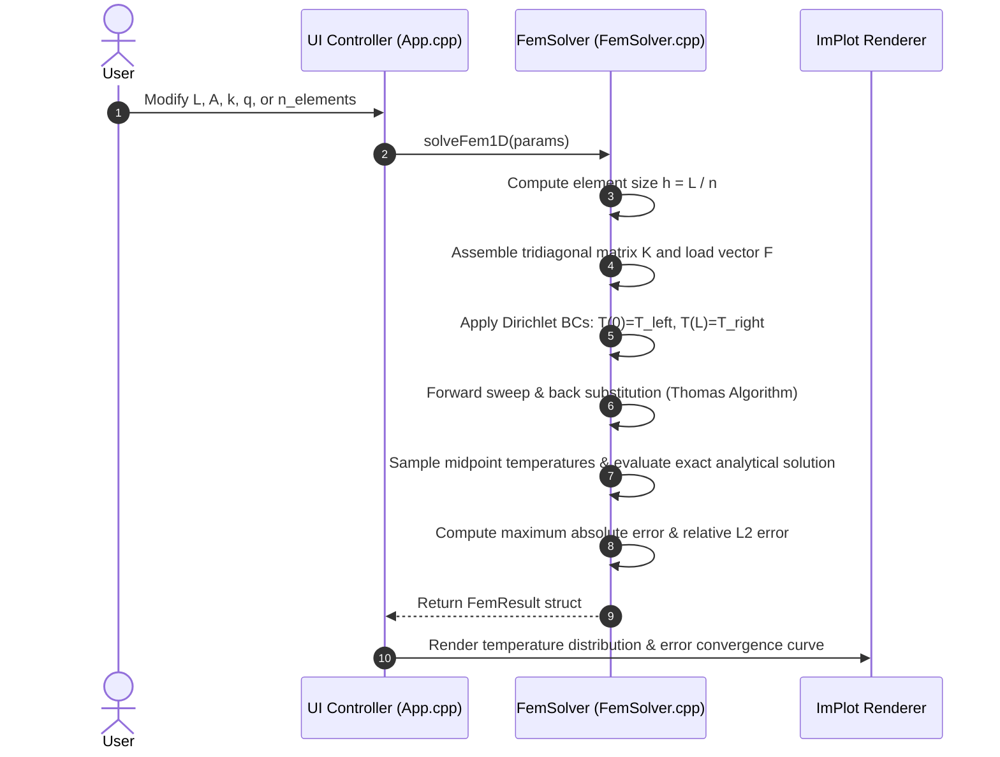
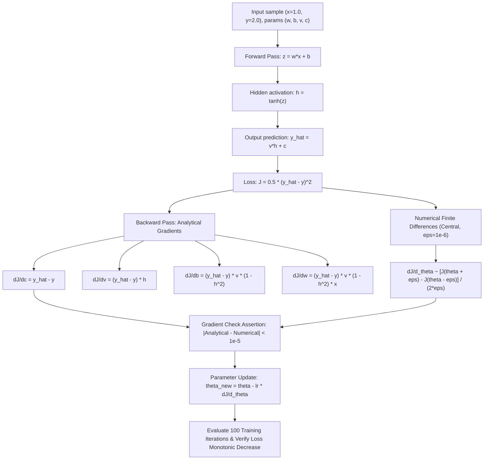
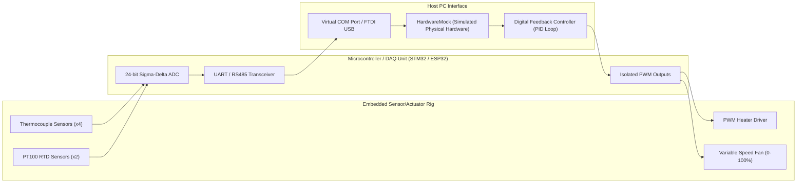

# THERMATRIX Architecture and Block Diagrams

This document illustrates the hardware and software architecture of the **THERMATRIX** Engineering Workbench, detailing system boundaries, component separation, communication protocols, and data flow.

---

## 1. Top-Level System Block Diagram

```mermaid
graph TB
    subgraph "External Hardware Environment (Physical / Simulated)"
        SENS1["Thermocouple / RTD Sensors (PT100)"]
        SENS2["Infrared Thermal Sensor (I2C)"]
        ACT1["Thermoelectric Cooler / Heater (PWM)"]
        ACT2["Cooling Fan / Blower (0-10V Tach)"]
        PLC["Industrial Controller / PLC (Modbus TCP)"]
    end

    subgraph "Hardware Abstraction & I/O Layer"
        MB["Modbus RTU/TCP Driver"]
        CAN["CAN / Serial Driver"]
        MOCK["HardwareMock Adapter (Thread-Safe Mock Rig)"]
    end

    subgraph "THERMATRIX Native Core (C++17 Engine)"
        CORE_P["Parsers (ASCII STL & Temperature CSV)"]
        CORE_FEM["FEM 1D Steady-State Solver (Tridiagonal TDMA)"]
        CORE_BP["Backprop Gradient Engine & Optimizer"]
        CORE_BENCH["Multi-Threaded Benchmark Engine (OpenMP)"]
    end

    subgraph "Presentation & Rendering Layer (C++17 + OpenGL)"
        APP["App Shell & State Manager"]
        GUI["Dear ImGui Immediate-Mode Framework"]
        PLOT["ImPlot Dynamic Plotting Engine"]
        GL["OpenGL 3.3 Hardware Accelerated Viewport"]
    end

    SENS1 --> MB
    SENS2 --> CAN
    ACT1 <-- MB
    ACT2 <-- CAN
    PLC <--> MB
    MB -.-> MOCK
    CAN -.-> MOCK

    MOCK --> APP
    CORE_P --> APP
    CORE_FEM --> APP
    CORE_BP --> APP
    CORE_BENCH --> APP

    APP --> GUI
    GUI --> PLOT
    GUI --> GL
```

---

## 2. Software Architecture and Strict Decoupling

The workbench enforces a strict separation between numerical/hardware core logic and presentation/transport code:

```
+-------------------------------------------------------------------------+
|                          THERMATRIX Presentation                        |
|                                                                         |
|  [Tab 1: Geometry]    [Tab 2: FEM Thermal]   [Tab 3: Perf/Backprop]    |
|   - 3D Wireframe       - Interactive Params   - Strong Scaling Plots    |
|   - Point Cloud        - Exact vs FEM plots   - Loss curve & FD table   |
|   - Color mapping      - Mesh Convergence     - CPU/RAM Telemetry       |
|                                                                         |
|  [Tab 4: Hardware Integration & Telemetry]                              |
|   - Real-time sensor polling (10 Hz)                                    |
|   - Closed-loop PID setpoint adjustments                                |
|   - Device health, connection status & bus activity                      |
+-------------------------------------------------------------------------+
                                    |
                        (C++ Callbacks & State)
                                    v
+-------------------------------------------------------------------------+
|                        THERMATRIX Core (C++17)                          |
|                                                                         |
|  StlParser           CsvParser          FemSolver                       |
|   * ASCII STL reader  * Node validator   * Weak form formulation        |
|   * Boundary box      * Field statistics * O(N) Thomas Algorithm TDMA   |
|                                                                         |
|  BackpropSolver                         BenchmarkEngine                 |
|   * Forward pass: z=wx+b, h=tanh, y=vh+c * Thread-pool / OpenMP         |
|   * Exact analytical gradients           * Strong scaling (1..p cores)  |
|   * Finite difference verification       * Deterministic PRNG seed      |
|                                                                         |
|  HardwareMock Adapter                                                   |
|   * Modbus RTU / CAN bus registers                                      |
|   * Simulated thermal response with Newton cooling                      |
|   * Thread-safe sensor polling & alarm thresholds                       |
+-------------------------------------------------------------------------+
```

---

## 3. Thermal FEM Calculation Flow



---

## 4. Backpropagation Gradient Verification Flow



---

## 5. Hardware Interfacing Block Diagram



---

## 6. Embedded System Interface and Pin-Voltage Specification (Task E)

### 6.1 Modular Hardware Overview
The workbench integrates three distinct hardware entities connected to the host PC via dedicated buses:
1. **Microcontroller Board (MCU)**: STMicroelectronics STM32F401RE (ARM Cortex-M4, 84 MHz) handling real-time multi-channel sensor acquisition (ADC), PWM heater driving, and fan tachometer capture.
2. **FPGA Acceleration Board**: Xilinx Artix-7 (XC7A35T-1FTG256C) executing pipelined fixed-point/floating-point thermal matrix operations and high-speed data decimation.
3. **JTAG Debug Adapter**: SEGGER J-Link BASE / OpenOCD CMSIS-DAP dedicated hardware debugger for target flashing, memory inspection, and non-intrusive boundary scanning.

---

### 6.2 Concise Interface, Pinout, and Voltage Domain Table

| Signal / Pin Group | MCU Board (STM32F4) | FPGA Board (Artix-7) | JTAG Debug Adapter | Voltage Domain | Level Shifting Required? | Connector Type | Signal Direction & Ownership |
| :--- | :--- | :--- | :--- | :--- | :--- | :--- | :--- |
| **Main Power (VBUS)** | 5.0 V (USB VBUS) | 5.0 V / 12 V Ext DC | 5.0 V (USB Host) | 5.0 V / 12.0 V | N/A (Regulated) | USB-C / 2.1mm DC Barrel | Host $\to$ Device Power Rails |
| **Digital Core Logic** | 3.3 V (LDO output) | 1.0 V (VCCINT) | Internal 3.3 V | 1.0 V – 3.3 V | On-board DC-DC buck | Internal BGA | Board Power Distribution |
| **I/O Bank Voltages** | 3.3 V (VDD) | 1.8 V / 2.5 V / 3.3 V (VCCO)| 1.2 V – 5.0 V (VREF) | 1.8 V – 3.3 V | Bidirectional TXB0108 / SN74LVC | 0.1" Pitch Headers | Target I/O References |
| **System Ground (GND)**| Star Ground GND | Chassis/Plane GND | Common Reference GND | 0.0 V (Common) | Single-point star bonding | Shielded Cable Ground | Common Return Path |
| **Host Communication** | USB Virtual COM / UART | USB-FTDI (SPI/FT232H) | USB High-Speed (480 Mbps) | 3.3 V Diff (USB) | Integrated PHY | USB Type-C & Type-B | Bidirectional Host Link |
| **JTAG TCK (Clock)** | PA14 (SWCLK / TCK) | Pin P10 (TCK) | TCK Output (Pin 9) | Matched to VREF (Target)| Buffer / Series 22Ω resistor | Standard 20-pin / 10-pin Cortex | Adapter (Master) $\to$ Target (Slave) |
| **JTAG TMS / SWDIO** | PA13 (SWDIO / TMS) | Pin N10 (TMS) | TMS Output (Pin 7) | Matched to VREF (Target)| Bidirectional auto-sensing | Standard 20-pin / 10-pin Cortex | Adapter (Master) $\to$ Target (Slave) |
| **JTAG TDI (Data In)** | PA15 (JTDI) | Pin N11 (TDI) | TDI Output (Pin 5) | Matched to VREF (Target)| Series termination resistor | Standard 20-pin / 10-pin Cortex | Adapter (Master) $\to$ Target (Slave) |
| **JTAG TDO (Data Out)**| PB3 (JTDO) | Pin M12 (TDO) | TDO Input (Pin 13) | Matched to VREF (Target)| Low-capacitance buffer | Standard 20-pin / 10-pin Cortex | Target (Slave) $\to$ Adapter (Master) |
| **nTRST / nRESET** | NRST (Bi-directional) | Pin R11 (PROG_B) | nSRST (Open-drain, Pin 15)| 3.3 V Pull-Up | Open-drain with 10kΩ pull-up | Standard 20-pin Header | Adapter (Master) $\to$ Target Reset |
| **Inter-Board Bus** | SPI Master (MOSI/MISO/SCK)| SPI Slave (Bank 14) | Not Connected | 3.3 V $\leftrightarrow$ 1.8 V | Active Level Shifter (SN74AVC4T245)| 6-pin PMOD Header | MCU $\to$ FPGA High-Speed Bus |
| **PWM Fan / Heater Drive**| TIM3_CH1 (PWM 25 kHz) | Monitoring input | Not Connected | 3.3 V $\to$ 12 V / 24 V | MOSFET Driver (TC4427A)| Screw Terminal Block | MCU $\to$ Power Actuators |

---

### 6.3 Why a JTAG Adapter is a Debug Interface, NOT a Compute Board

It is a critical electrical and architectural error to assume that a JTAG debug adapter is an interchangeable compute accelerator or generic I/O board. The reasons are rooted in IEEE 1149.1 standards:
1. **Protocol Intent**: JTAG (Joint Test Action Group) is fundamentally a state-machine driven boundary-scan and test architecture consisting of a Test Access Port (TAP) controller (Test-Logic-Reset, Run-Test/Idle, Select-DR-Scan, Select-IR-Scan, etc.). It was designed for structural continuity testing, silicon manufacturing defect detection, and hardware register/memory patching.
2. **Bandwidth and Latency Asymmetry**: JTAG relies on single-bit serial shifting via TDI and TDO on TCK clock edges. Even high-end debuggers operating at 20 MHz achieve sustained data throughputs of less than 1–2 MB/s due to shift-register instruction overhead. Using JTAG as a streaming pipeline for real-time thermal simulation or telemetry is unfeasible.
3. **Master-Slave Ownership**: The JTAG adapter is strictly an active bus master that halts the target CPU core or injects test instructions into the scan chain. Connecting multiple targets requires chaining boundary-scan registers in series ($TDO \to TDI$) or multiplexing TAP controllers, not peer-to-peer bus arbitration.
4. **Voltage Reference Dependency**: A JTAG adapter does not supply I/O power; it derives its logic thresholds from the target board's $V_{\text{REF}} / V_{\text{TARGET}}$ pin. Forcing a fixed 3.3 V JTAG signal onto a 1.2 V FPGA core logic boundary will cause catastrophic ESD diode destruction.

---

### 6.4 Safe Integration and Failure Recovery Plan
- **Galvanic Isolation**: ADuM1401 digital isolators decouple the MCU PWM outputs from the 24 V high-power heating elements, preventing ground loops.
- **Level Shifting**: Dedicated direction-controlled voltage translators (TI TXS0108E for open-drain I2C and SN74LVC8T245 for high-speed SPI) bridge 1.8 V FPGA banks to 3.3 V MCU peripherals.
- **Recoverable Timeout Handling**: The C++ `HardwareMock` engine models communication dropouts, CRC errors, and timeout events. If a sensor fails to respond within 150 ms, the state machine enters `ConnectState::Error`, disengages PWM heater drive, triggers an audible/visual alarm in the UI, and allows the operator to click "Reconnect / Reset" to restore safe operation without restarting the workbench.

